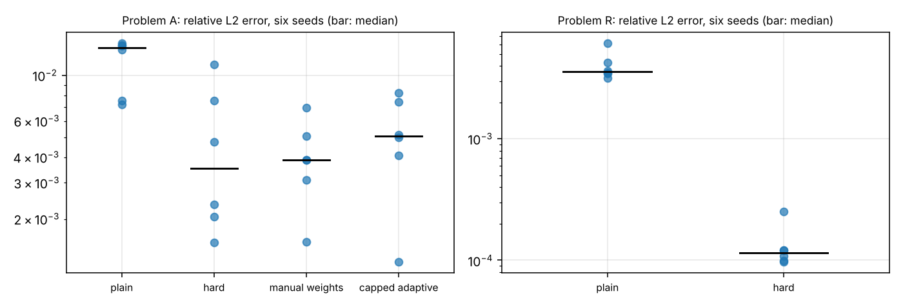
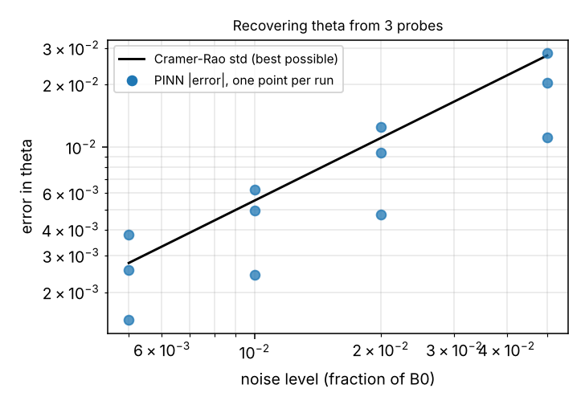

# mag-diffusion-pinn

Physics-informed neural networks (PINNs) for 1D resistive magnetic diffusion, b_t = θ b_ξξ, validated against analytic and finite-difference baselines. It covers the forward problem (three variants, several training improvements) and an inverse problem (recovering the diffusivity from sparse, noisy probe data). See [SPEC.md](SPEC.md) for the plan and milestones.

## Headline results

All numbers are from the cached runs in `results/`; `python scripts/reproduce_headlines.py` prints them and redraws the figures below. They come from one network size (4 × 64, tanh), one training budget (2000 Adam + 2000 L-BFGS steps) and float32, with six seeds for the main forward comparisons. They say what helped *in this setup*, not what is generally best.

**Forward problems** (relative L2 error against the exact solution, median over six seeds):

| Problem | Plain PINN | Best variant | Notes |
|---|---|---|---|
| R: smooth ramp at the boundary | 3.6e-3 | **1.1e-4** (hard constraints) | about 31 times better; every hard-constrained seed beats every plain seed |
| A: step at the boundary | 1.4e-2 | 3.5e-3 (hard), 3.9e-3 (manual weights) | about 4 times better; the seed-to-seed spread is as large as the gap between the best variants; not below 1e-3 |
| S: smooth initial profile | about 1e-3 | | float32 narrowly misses the 1e-3 target; see notebook 02 |

**Inverse problem** (true θ = 0.6, PINN starts at 1.0, three probes, 20 times each): with 1% noise the PINN recovers θ to within 0.4% to 1.0% over three noise draws; the statistical limit (Cramér–Rao) is 0.9%. Noise-free recovery is 0.06%. The PINN tracks classical least squares on the exact forward model (median difference 0.2 of the Cramér–Rao standard deviation) and is not better than it. See notebook 04 for the noise and probe-placement studies and their caveats.

## Install and test

    git clone <this repository> && cd mag-diffusion-pinn
    python -m venv .venv && source .venv/bin/activate      # or: pyenv activate <env>
    pip install -e ".[dev]"
    pytest                                                 # about 30 seconds on a laptop CPU

The tests check the analytic solutions against the PDE and each other, the finite-difference solvers (second-order convergence, agreement with the reference), the autograd residual on a manufactured solution, the hard-constraint boundary conditions, short training runs for each PINN option, the inverse tools (least squares recovers θ, its scatter matches the Cramér–Rao bound), and that the cached results contain the numbers quoted above. `requirements-lock.txt` lists the exact package versions the tests and cached runs were produced with.

## Reproduce

    python scripts/reproduce_headlines.py     # prints the headline numbers, writes figures/*.png (no training)
    jupyter lab notebooks/                    # the full analysis, with caveats

Retraining one forward run (about 4 minutes on one CPU core; the cached runs used these settings):

    import numpy as np
    from mag_diffusion_pinn import pinn
    from mag_diffusion_pinn.reference import ramp_reference_grid
    xi, tau = np.linspace(0, 1, 201), np.linspace(0.0025, 0.5, 200)
    ref = ramp_reference_grid(xi, tau)
    model, hist, metrics, pred = pinn.train("R", dict(hard=True), ref, xi, tau, seed=0)
    print(metrics["rel_l2"])

Retraining one inverse run (about 5 minutes):

    import numpy as np
    from mag_diffusion_pinn.inverse import make_probes, synth, run_job
    xd, td = make_probes([0.2, 0.5, 0.8])
    clean, y = synth(xd, td, 0.6, 0.01, np.random.default_rng(100))
    print(run_job(xd, td, y, seed=0)["theta"])

## Layout

    src/mag_diffusion_pinn/   reference.py (analytic + Duhamel references), fd.py, pinn.py, inverse.py
    tests/                    pytest suite
    scripts/                  reproduce_headlines.py
    notebooks/                01 baselines, 02 plain PINN, 03 improvements, 04 inverse problem
    results/, data/           cached training runs and reference fields used by the notebooks and tests
    figures/                  figures embedded above

**Reproducibility across machines.** Training is not bitwise reproducible between machines: the same code, seeds and settings gave different numbers on an Apple-silicon laptop and on the Linux machine that produced the cached runs. For example, the notebook-02 float32 runs on S gave 6.0e-4, 1.2e-3, 1.1e-3 on the laptop and 1.0e-3, 1.2e-3, 1.4e-3 here, and on A the median was 1.21e-2 against 1.33e-2. The laptop results are kept as `results/m2_runs_mac.pkl`; everything quoted in the notebooks and this README comes from `results/m2_runs.pkl` and the other cached runs, which match `requirements-lock.txt`. The differences are within the seed-to-seed spread, so the conclusions do not depend on which set is used, but individual numbers do.

**Notebooks and package.** The notebooks keep their own embedded copies of the code, so each reads as a self-contained report. `src/mag_diffusion_pinn/` is the maintained version of the same code, and the tests exercise it. The cached runs in `results/` were produced by the notebook versions; the package is a refactor of them and was not used to regenerate them.

## Status

| Milestone | State |
|---|---|
| M1 baselines (`01_baselines.ipynb`) | done |
| M2 plain PINN on S and A (`02_plain_pinn.ipynb`) | done; S error 1.0e-3 to 1.4e-3 in float32 (target 1e-3), 6.6e-4 in float64 (one seed); A fails at the early-time corner |
| M3 improvements (`03_improvements.ipynb`) | done; adds smooth-ramp problem R; see the table above |
| M4 inverse problem (`04_inverse.ipynb`) | done; see above |
| M5 package, tests, reproducibility | done; `pytest` passes in a fresh environment |
